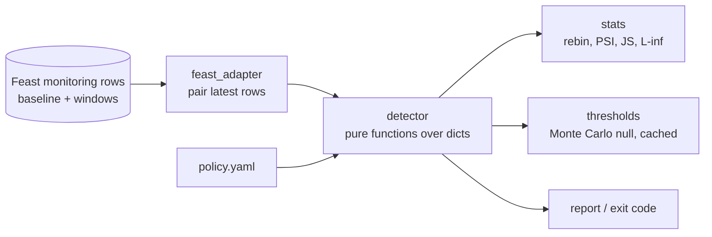

# skewguard

Drift and training-serving skew detection for [Feast](https://github.com/feast-dev/feast)'s
data-quality monitoring. Feast 0.67 computes per-feature statistics for training data
and serving logs, but nothing compares them or raises an alert. skewguard reads those
metrics and alerts on distribution shift, null bursts, range violations, new
categories and stale data. Its thresholds are **calibrated to each window's sample
size**: a fixed rule like PSI > 0.25 fires on 8.6% of clean 116-row windows, yet at
1,000+ rows it is more than five times the clean-data 95th percentile. skewguard's
simulated thresholds hold the false-positive rate at its 1% target (measured
0.4–1.1%) from 116 to 5,000 rows.

> **Status:** early (week 2). The detector, its tests and the clean-data
> calibration are done. The labelled fault injector (`skewguard.inject`) and the
> evaluation harness (`scripts/eval_harness.py`) exist, and the harness has run end
> to end on the March 2024 tuning range. Detection power on injected faults hasn't
> been measured yet. It will be measured on April–June 2024 under the
> pre-registered plan in [docs/eval-plan.md](docs/eval-plan.md).

## Quick start

```bash
pip install -e ".[feast,dev]"
feast init demo && cd demo/feature_repo
printf '\ndata_quality_monitoring:\n  auto_baseline: true\n' >> feature_store.yaml
feast apply && feast monitor run
skewguard check                    # drift: batch baseline vs latest daily batch window
skewguard check --source log       # skew: batch baseline vs serving logs
skewguard check --json --policy policy.example.yaml
```

The command exits with 1 when any feature alerts, so a cron job or CI step can act on it.

```
FEATURE                         WINDOW                  ROWS  STATUS  DETAIL
driver_hourly_stats.acc_rate    batch/daily/2026-10-17  125   OK      psi=0.06034 (limit 0.3452)
driver_hourly_stats.conv_rate   batch/daily/2026-10-17  125   OK      psi=0.1258 (limit 0.2984)
```

## What it checks

| Check | Statistic | Threshold |
|---|---|---|
| `psi` / `js` | PSI or Jensen-Shannon after rebinning the window onto the baseline's edges | (1 - alpha) quantile of a simulated no-drift distribution for this window size |
| `out_of_range` | share of window mass outside the baseline's [min, max] | `max_unseen_mass` (default 1%) |
| `linf` | L-inf distance between category frequencies (lower bound under top-N truncation) | simulated, as above |
| `new_categories` | share of window in values the baseline provably never had | `max_unseen_mass` |
| `null_rate` | one-sided two-proportion z-test | p < alpha |
| `freshness` | now minus newest event | `max_staleness` per feature view |
| `type` | numeric vs categorical changed | always alerts |

## How it works



Three facts about Feast's internals drove the design (details with file:line in
[docs/feast-notes.md](docs/feast-notes.md)):

1. **Every window computes its own histogram edges** (`np.histogram(values, bins=20)`),
   so stored histograms can't be compared bin by bin. `stats.rebin` moves the
   window's mass onto the baseline's edges and keeps out-of-range mass instead of
   dropping it.
2. **Offline stores disagree on constant columns.** SQL backends store one
   zero-width bin; the file backend stores 20 bins over [v-0.5, v+0.5]. Both are
   handled.
3. **The baseline includes the newest windows.** p-values are therefore
   conservative; see [Limitations](#limitations).

## Results so far (clean data only)

From [docs/noise_floor_output.md](docs/noise_floor_output.md) (`python scripts/noise_floor.py`):

| window rows | median PSI | P(PSI > 0.2) | P(PSI > 0.25) | simulated limit | its false-positive rate |
|---|---|---|---|---|---|
| 116 | 0.153 | 23.2% | 8.6% | 0.388 | 1.0% |
| 1,000 | 0.029 | 0.0% | 0.0% | 0.057 | 1.1% |
| 5,000 | 0.015 | 0.0% | 0.0% | 0.030 | 0.4% |

The target false-positive rate was 1%. Each column is measured on 2,000 independent
pairs from one distribution, with a 1,808-row baseline as in the Feast demo.

## Layout

```
src/skewguard/
  stats.py          rebin, PSI, JS, L-inf bounds, null-rate test   (pure Python)
  thresholds.py     Monte Carlo no-drift distributions             (numpy)
  detector.py       per-feature checks over Feast monitoring rows  (no Feast import)
  policy.py         per-view / per-feature YAML policies
  feast_adapter.py  the only module that imports Feast
  cli.py            `skewguard check`
  inject.py         labelled faults for the evaluation                (pandas)
scripts/            eval_harness.py, analyze.py, noise_floor.py,
                    repro_stale_online_read.py, repro_backend_histograms.py
docs/               feast-notes.md, eval-plan.md, upstream/ (Feast issue + patch drafts)
results/            <run>.parquet, run summaries, tuning and RESULTS files
```

## Development

```bash
pip install -e ".[feast,dev,eval]"
pytest -m "not integration"   # fast unit + property tests
pytest -m integration         # runs feast init/apply/monitor in a temp dir (~2 min)
ruff check . && ruff format --check .
```

The evaluation harness downloads NYC TLC trip data into `data/` (gitignored), builds
a Feast repo with a January–February baseline, and writes `results/<run>.parquet`.
The evaluation range (April–June) is refused unless `--final` is passed.

```bash
python scripts/eval_harness.py download 2024-01 2024-02 2024-03
python scripts/eval_harness.py run --range tune   # March, ~25 min; resumable
```

`scripts/analyze.py` applies the analysis rules fixed in the plan's Deviation 10
before any March detection value was read. `tune` picks `max_unseen_mass` and the
matched fixed thresholds from March; `report` writes the results tables,
intervals and tests for an evaluation run:

```bash
python scripts/analyze.py tune results/tune-20240301-20240331.parquet
python scripts/analyze.py report results/<eval-run>.parquet \
    --tuning results/tune-20240301-20240331.tuning.json
```

## Limitations

- The null simulation assumes values are uniform within each baseline bin.
- When the window lies inside the baseline period (Feast's `auto_baseline` covers
  all history), PSI is biased low and alerts are conservative.
- alpha is per check. With many features, expect family-wise false alarms; see
  [docs/eval-plan.md](docs/eval-plan.md).
- Serving logs are only written by Feast's Go feature server, and Feast drops the
  per-feature `__timestamp` columns from log metrics, so serving-time staleness
  isn't visible here yet.

## Code provenance

All code in this repository is original. It reads Feast's monitoring tables
through Feast's public `MonitoringService` API and copies no Feast source. The
`tests/conftest.py` helpers reimplement the shape of Feast's
`MetricsCalculator`, and an integration test checks them against the real one.
Feast is Apache-2.0; this project is Apache-2.0 too.

Built with help from an AI coding assistant. The design decisions, findings and
evaluation plan are recorded in `docs/` and in the commit history.
