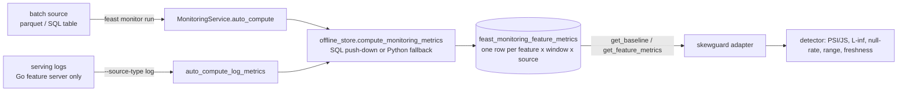

# How Feast's monitoring works (reverse-engineering notes)

Source: `feast-dev/feast` at tag **v0.67.0**, commit `2dfb9e6d1a37719fd11028d916094050f1cdd552`
(2026-10-13). Paths are relative to `sdk/python/feast/`. Line numbers are for that
commit and will drift. Every claim below was checked against the code, and most were
also checked by running `feast init` → `feast apply` → `feast monitor run` on Windows
with Python 3.12 (Oct 18, 2026).

## 1. The pipeline in one picture

## 2. What gets computed

| Step | Where | What it does |
|---|---|---|
| Classify | `monitoring/metrics_calculator.py:43-71` | INT32/64, FLOAT32/64 and DECIMAL count as numeric; STRING and BOOL count as categorical. Map, Json and Struct are skipped with a warning (seen on the demo: `driver_metadata`, `driver_config`, `driver_profile`). |
| Numeric stats | `metrics_calculator.py:73-123` | row/null counts, mean, stddev (ddof=1), min, max, p50/75/90/95/99, and a histogram from `np.histogram(values, bins=20)` (line 114). |
| Categorical stats | `metrics_calculator.py:125-166` | Top 10 values by count, plus `other_count` and `unique_count`. |
| Windows | `monitoring/monitoring_service.py:24-30` | daily 1d, weekly 7d, biweekly 14d, monthly 30d, quarterly 90d. |
| Auto run | `monitoring_service.py:121-231` | Each window is `[max_ts - window, max_ts]`, where `max_ts` is the source's newest event, **not "now"** (lines 190-197). `metric_date` is the window's start date (line 202). |
| Baseline | `monitoring_service.py:163-187`, `407-484` | Computed once per feature over **all history** (`_EPOCH` to `_FAR_FUTURE`). It is idempotent: features that already have a baseline are skipped. |
| Storage | `monitoring/monitoring_utils.py:42-75` | One row per (project, feature_view, feature, metric_date, granularity, data_source_type). Same-key reruns upsert. |
| Log source | `monitoring_service.py:1051-1119`, `1202-1281` | Log columns `fv__feat` are mapped back to `(feature_view, feature)` so batch and log rows share an identity. The comment at lines 1216-1219 says this is so "drift detection can join batch and log metrics", but no drift code exists. |
| Jobs | `monitoring/dqm_job_manager.py:9-12` | pending → running → completed / failed. |

Backends implement `compute_monitoring_metrics` themselves: dask at
`infra/offline_stores/dask.py:617-648`, and also DuckDB, Postgres, Snowflake,
BigQuery, Redshift, Spark, Trino and Oracle. Only when a backend raises
`NotImplementedError` does Feast fall back to `MetricsCalculator`
(`monitoring_service.py:1161-1200`).

## 3. Findings that shape skewguard

**F1. Histograms from different windows aren't comparable as stored.** Every window
calls `np.histogram` over its own min/max (`metrics_calculator.py:114`,
`dask.py:856`). On the demo, conv_rate's baseline edges start at 0.0002 and the daily
window's at 0.0167. The counts can't be subtracted bin by bin. → `stats.rebin` moves
the window's mass onto the baseline's edges, assuming values are uniform within each
bin. Mass outside the baseline's range is kept as `below`/`above` rather than
dropped. Also tested in `tests/test_integration_feast.py`.

**F2. A fixed PSI threshold doesn't account for sample size.** See
`docs/noise_floor_output.md`. At 116 rows, PSI > 0.25 fires on 8.6% of clean windows,
and PSI > 0.2 (the threshold proposed in a #6341 comment) fires on 23%. At 1,000+ rows
the clean-data p95 is 0.047 or lower, so neither threshold ever fires and both are far
above the noise. → `thresholds.numeric_null` simulates the no-drift distribution for
the actual window size. Its false-positive rate, averaged over 50 baselines, was
1.0% / 1.1% / 1.1% / 0.4% at 116 / 125 / 1,000 / 5,000 rows against a 1% target.

**F3. Backends disagree on constant columns.** For a column where min == max:
- DuckDB, Postgres and other SQL backends return `{"bins": [v, v], "counts": [n]}`
  (`duckdb.py:513-518`, `contrib/postgres_offline_store/postgres.py:1206-1211`).
- dask and the Python fallback call `np.histogram`, which widens the range to
  `[v-0.5, v+0.5]` and returns 20 bins.

The same data therefore gives different histogram shapes depending on the offline
store. → `rebin` treats a zero-width bin as a point mass, and `thresholds.feast_histogram`
mimics both conventions.

The backends also disagree on values that sit exactly on an interior edge. DuckDB
uses `FLOOR((x - min) / bin_width) + 1`, and `33 / 2.2` evaluates to
`14.999999999999998`, so 33 lands in bin 14. numpy corrects its index against
`linspace` edges and puts 33 in bin 15. Over integer columns `0..hi` with
`hi = 1..199`, DuckDB and dask counts differed in 5 of 199 datasets.

Both cases are reproduced in `scripts/repro_backend_histograms.py`. Feast's own
`TestCrossBackendConsistency` compares means, null rates and top categories, but
never histograms. The upstream issue draft and a tested patch for the constant
case are in [upstream/](upstream/README.md).

**Unused UI code:** `ui/src/pages/monitoring/components/HistogramChart.tsx:145-148`
can overlay a baseline by drawing `baseline.counts[i]` on top of window bar `i`.
That's wrong once edges differ (F1), and it compares raw counts rather than
proportions. In v0.67.0 nothing passes `baseline` to the chart, so it is not a live
bug. Anyone who wires the overlay up needs to rebin first.

**F4. The baseline contains the window.** The baseline covers all history, including
the most recent days that the daily window also covers. Baseline and window are
therefore positively correlated, PSI is biased low, and the simulated p-value is
conservative. Seen on the demo: `acc_rate` p = 0.99. → Documented as a limitation.
A baseline built from a time range that excludes the window removes the bias.

**F5. No drift code exists.** A grep of `monitoring/` for drift, PSI, KS, JS,
threshold and alert finds only the docstrings at `monitoring_service.py:1061` and
`:1218`. The UI's health badge is a fixed null-rate rule. Upstream issue
[#6341](https://github.com/feast-dev/feast/issues/6341) ("Built-in feature drift
detection with alerting") is open and unassigned as of 2026-10-18.

**F6. Monitoring discards serving-time freshness.** The log schema includes
`fv__feat__timestamp` and `fv__feat__status` per feature (`feature_logging.py:50-102`),
but `_resolve_log_source` drops every `__timestamp` and `__status` column
(`monitoring_service.py:1108-1109`). Only the Go feature server writes logs
(`go/internal/feast/server/logging/logger.go`); the Python `feast serve` writes none.

**F7. The default Python online read never checks TTL.**
`utils._populate_response_from_feature_data` (`utils.py:1823`) only sets `PRESENT` or
`NOT_FOUND` (lines 1876-1877, 1907). `OUTSIDE_MAX_AGE` is set only in the
precomputed fast path (`infra/online_stores/online_store.py:693-736`), the Go server
and the Java server. So a feature far older than its TTL is served as `PRESENT` by
the default Python/SQLite path. Reproduced with `scripts/repro_stale_online_read.py`:
all 5 demo drivers were 72.7 h old against a 24 h TTL, and every one came back `PRESENT`.
**Already known upstream:** issue [#6821](https://github.com/feast-dev/feast/issues/6821)
(open since 2026-09-07) and fix PR [#7002](https://github.com/feast-dev/feast/pull/7002)
(open since 2026-10-13). Don't duplicate it. Useful public work instead: test #7002
with this reproduction and post the latency overhead measured with and without the fix.

## 4. Retrieval paths (needed to reason about skew)

**`FeatureStore.get_historical_features`** (`feature_store.py:1988`) → `PassthroughProvider`
→ `DaskOfflineStore.get_historical_features` (`dask.py:148-369`). The point-in-time
join is a dask merge on join keys followed by filters:
- `_filter_ttl` (`dask.py:1187`) keeps rows with `entity_ts - ttl <= feature_ts <= entity_ts`.
- `_drop_duplicates` (`dask.py:1249`) sorts by created timestamp, then event timestamp,
  and keeps the last row per entity row, so the newest event wins.
- SQL stores render a Jinja template through `offline_utils.build_point_in_time_query`
  (`offline_utils.py:202`) with the same conditions. The context, including TTL in
  seconds and the min/max event timestamps, comes from
  `get_feature_view_query_context` (`offline_utils.py:108`).

**`FeatureStore.get_online_features`** (`feature_store.py:3962`) →
`OnlineStore.get_online_features` → `SqliteOnlineStore.online_read` returns
`(event_ts, values)` per entity → `_populate_response_from_feature_data` builds the
response. Event timestamps are available via
`OnlineResponse.to_dict(include_event_timestamps=True)`.

**Where a freshness guard costs least:** at `utils.py:1907`, where `row_ts` and
`table.ttl` are both in hand. Setting `OUTSIDE_MAX_AGE` there needs no extra I/O and
covers SQLite, Redis and Postgres, because they all call this helper. A guard that
wraps `get_online_features` from outside Feast costs one extra pass over the response.

## 5. Interview questions these notes answer

- Why can't you compare Feast's stored histograms directly? (F1)
- Why is PSI > 0.25 wrong for a 100-row window, and wrong in a different way for a
  5,000-row window? (F2)
- How does the point-in-time join prevent leakage, and what does TTL do there? (§4)
- Where would you put a freshness check, and what does it cost? (F7, §4)
